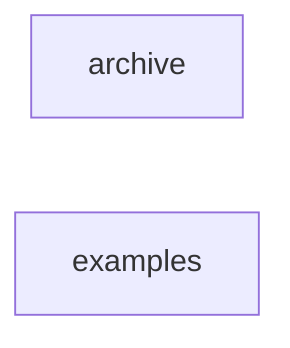

_Generated by CodeAtlas._

## Details

Owns 0 symbols across 0 file(s).

### archive

Owns 0 symbols across 15 file(s).

**Related Classes/Methods:** _None_

### examples

Owns 7 symbols across 5 file(s).

**Related Classes/Methods:** _None_

**Source Files:**

- `docs/examples/rest_api_client.py`
  - `docs.examples.rest_api_client.PyBlastRadiusClient`
  - `docs.examples.rest_api_client.PyBlastRadiusClient.__init__`
  - `docs.examples.rest_api_client.PyBlastRadiusClient.analyze`
  - `docs.examples.rest_api_client.PyBlastRadiusClient.criticality`
  - `docs.examples.rest_api_client.PyBlastRadiusClient.health_check`
  - `docs.examples.rest_api_client.PyBlastRadiusClient.scan`
  - `docs.examples.rest_api_client.main`
