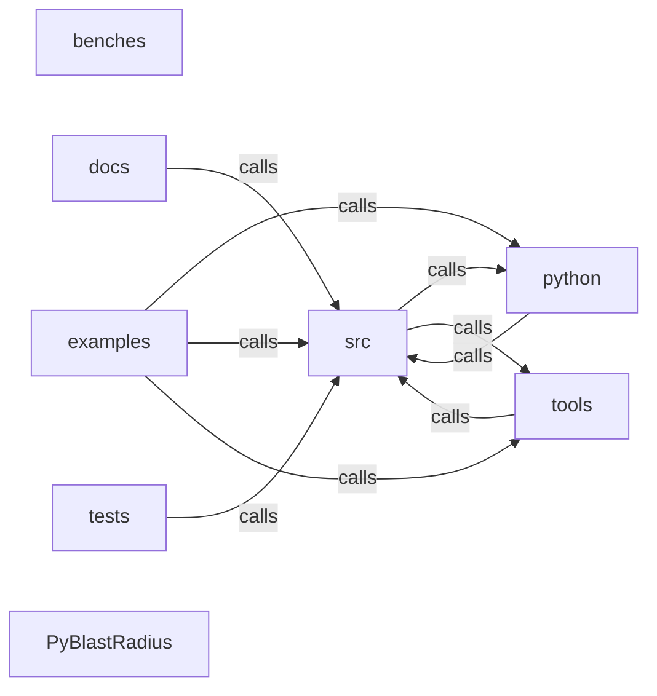

_Generated by CodeAtlas._

## Details

Architecture map of PyBlastRadius.

### benches

Owns 4 symbols across 1 file(s).

**Related Classes/Methods:** _None_

**Source Files:**

- `benches/large_graph.rs`
  - `benches.large_graph.bench_blast_radius_analysis`
  - `benches.large_graph.bench_criticality_scoring`
  - `benches.large_graph.bench_graph_construction`
  - `benches.large_graph.build_layered_graph`

### docs

Owns 0 symbols across 0 file(s).

**Related Classes/Methods:** _None_

### examples

Owns 6 symbols across 1 file(s).

**Related Classes/Methods:** _None_

**Source Files:**

- `examples/cli.rs`
  - `examples.cli.Cli`
  - `examples.cli.Commands`
  - `examples.cli.export_format`
  - `examples.cli.find_node_by_name`
  - `examples.cli.main`
  - `examples.cli.parse_failure_type`

### python

Owns 0 symbols across 0 file(s).

**Related Classes/Methods:** _None_

### src

Owns 111 symbols across 3 file(s).

**Related Classes/Methods:** _None_

**Source Files:**

- `src/error.rs`
  - `src.error.Error`
  - `src.error.Error.analysis_error`
  - `src.error.Error.config_error`
  - `src.error.Error.discovery_error`
  - `src.error.Error.graph_error`
  - `src.error.Error.invalid_argument`
  - `src.error.Error.not_found`
  - `src.error.Error.parse_error`
- `src/lib.rs`
  - `src.lib.about`
- `src/python.rs`
  - `src.python.PyAirflowDiscoverer`
  - `src.python.PyAirflowDiscoverer.__repr__`
  - `src.python.PyAirflowDiscoverer.discover`
  - `src.python.PyAirflowDiscoverer.new`
  - `src.python.PyBlastRadiusAnalyzer`
  - `src.python.PyBlastRadiusAnalyzer.analyze`
  - `src.python.PyBlastRadiusResult`
  - `src.python.PyBlastRadiusResult.__repr__`
  - `src.python.PyBlastRadiusResult.from`
  - `src.python.PyCriticalityScore`
  - `src.python.PyCriticalityScore.__repr__`
  - `src.python.PyCriticalityScore.from`
  - `src.python.PyCriticalityScorer`
  - `src.python.PyCriticalityScorer.get_critical_nodes`
  - `src.python.PyCriticalityScorer.get_single_points_of_failure`
  - `src.python.PyCriticalityScorer.score_all`
  - `src.python.PyCriticalityScorer.score_node`
  - `src.python.PyEdge`
  - `src.python.PyEdge.__repr__`
  - `src.python.PyEdge.confidence`
  - `src.python.PyEdge.edge_type`
  - `src.python.PyEdge.error_rate`
  - `src.python.PyEdge.id`
  - `src.python.PyEdge.is_critical`
  - `src.python.PyEdge.latency_ms`
  - `src.python.PyEdge.new`
  - `src.python.PyEdge.set_error_rate`
  - `src.python.PyEdge.set_is_critical`
  - `src.python.PyEdge.set_latency_ms`
  - `src.python.PyEdge.source`
  - `src.python.PyEdge.target`
  - `src.python.PyEdgeType`
  - `src.python.PyEdgeType.from`
  - `src.python.PyFailureType`
  - `src.python.PyGraph`
  - `src.python.PyGraph.__repr__`
  - `src.python.PyGraph.add_edge`
  - `src.python.PyGraph.add_node`
  - `src.python.PyGraph.edge_count`
  - `src.python.PyGraph.edges`
  - `src.python.PyGraph.find_node_by_name`
  - `src.python.PyGraph.from_json`
  - `src.python.PyGraph.get_node`
  - `src.python.PyGraph.has_path`
  - `src.python.PyGraph.merge`
  - `src.python.PyGraph.metrics`
  - `src.python.PyGraph.neighbors`
  - `src.python.PyGraph.new`
  - `src.python.PyGraph.node_count`
  - `src.python.PyGraph.nodes`
  - `src.python.PyGraph.predecessors`
  - `src.python.PyGraph.to_dot`
  - `src.python.PyGraph.to_json`
  - `src.python.PyHealthStatus`
  - `src.python.PyHealthStatus.from`
  - `src.python.PyKubernetesDiscoverer`
  - `src.python.PyKubernetesDiscoverer.__repr__`
  - `src.python.PyKubernetesDiscoverer.discover`
  - `src.python.PyKubernetesDiscoverer.new`
  - `src.python.PyNode`
  - `src.python.PyNode.__repr__`
  - `src.python.PyNode.add_tag`
  - `src.python.PyNode.business_exposure`
  - `src.python.PyNode.confidence`
  - `src.python.PyNode.criticality`
  - `src.python.PyNode.health_status`
  - `src.python.PyNode.id`
  - `src.python.PyNode.name`
  - `src.python.PyNode.new`
  - `src.python.PyNode.node_type`
  - `src.python.PyNode.owner`
  - `src.python.PyNode.recovery_time_minutes`
  - `src.python.PyNode.set_business_exposure`
  - `src.python.PyNode.set_criticality`
  - `src.python.PyNode.set_health_status`
  - `src.python.PyNode.set_owner`
  - `src.python.PyNode.set_recovery_time_minutes`
  - `src.python.PyNode.tags`
  - `src.python.PyNodeType`
  - `src.python.PyNodeType.from`
  - `src.python.PyOtelDiscoverer`
  - `src.python.PyOtelDiscoverer.__repr__`
  - `src.python.PyOtelDiscoverer.discover`
  - `src.python.PyOtelDiscoverer.new`
  - `src.python.PySimulationResult`
  - `src.python.PySimulationResult.__repr__`
  - `src.python.PySimulationResult.from`
  - `src.python.PySimulator`
  - `src.python.PySimulator.simulate`
  - `src.python.PyTerraformDiscoverer`
  - `src.python.PyTerraformDiscoverer.__repr__`
  - `src.python.PyTerraformDiscoverer.discover`
  - `src.python.PyTerraformDiscoverer.new`
  - `src.python.REdgeType.from`
  - `src.python.RFailureType.from`
  - `src.python.RHealthStatus.from`
  - `src.python.RNodeType.from`
  - `src.python._core`
  - `src.python._unused`
  - `src.python.available_providers`
  - `src.python.core_err_to_py`
  - `src.python.parse_node_id`

### tests

Owns 59 symbols across 7 file(s).

**Related Classes/Methods:** _None_

**Source Files:**

- `tests/conftest.py`
  - `tests.conftest.sample_graph`
- `tests/test_analysis.py`
  - `tests.test_analysis.test_blast_radius_analyzer_direct_and_indirect_impact`
  - `tests.test_analysis.test_blast_radius_analyzer_leaf_node_has_no_downstream_impact`
  - `tests.test_analysis.test_blast_radius_analyzer_rejects_invalid_node_id`
  - `tests.test_analysis.test_blast_radius_analyzer_respects_max_depth`
  - `tests.test_analysis.test_criticality_scorer_flags_single_point_of_failure`
  - `tests.test_analysis.test_criticality_scorer_score_node_matches_score_all`
  - `tests.test_analysis.test_criticality_scorer_spof_detection_on_branching_topology`
  - `tests.test_analysis.test_simulator_different_failure_types_produce_results`
  - `tests.test_analysis.test_simulator_outage_produces_recovery_estimate`
- `tests/test_cli.py`
  - `tests.test_cli._build_graph`
  - `tests.test_cli._write_sample_graph`
  - `tests.test_cli.test_analyze_command_json_output`
  - `tests.test_cli.test_analyze_command_unknown_service_fails_cleanly`
  - `tests.test_cli.test_cli_module_imports_and_has_no_syntax_errors`
  - `tests.test_cli.test_criticality_command_json_output`
  - `tests.test_cli.test_simulate_command_known_scenario`
  - `tests.test_cli.test_simulate_command_unknown_scenario_fails_cleanly`
- `tests/test_codeatlas_adapter.py`
  - `tests.test_codeatlas_adapter._run`
  - `tests.test_codeatlas_adapter.test_check_reports_the_embedded_engine_available`
  - `tests.test_codeatlas_adapter.test_diagnose_summarises_the_architecture_map`
  - `tests.test_codeatlas_adapter.test_explain_reports_an_unknown_node_as_an_error`
  - `tests.test_codeatlas_adapter.test_god_nodes_are_ranked_by_degree`
- `tests/test_core_bindings.py`
  - `tests.test_core_bindings.test_core_extension_module_imports`
  - `tests.test_core_bindings.test_graph_add_node_and_get_node_roundtrip`
  - `tests.test_core_bindings.test_graph_find_node_by_name`
  - `tests.test_core_bindings.test_graph_get_node_missing_id_returns_none`
  - `tests.test_core_bindings.test_graph_has_path`
  - `tests.test_core_bindings.test_graph_json_roundtrip`
  - `tests.test_core_bindings.test_graph_merge_is_instance_method_not_static`
  - `tests.test_core_bindings.test_graph_metrics`
  - `tests.test_core_bindings.test_graph_neighbors_and_predecessors`
  - `tests.test_core_bindings.test_graph_to_dot_contains_node_names`
  - `tests.test_core_bindings.test_node_and_edge_basic_construction`
  - `tests.test_core_bindings.test_package_level_reexports_are_the_real_bindings`
- `tests/test_discovery_bindings.py`
  - `tests.test_discovery_bindings._edge_pairs`
  - `tests.test_discovery_bindings._node_names`
  - `tests.test_discovery_bindings._write`
  - `tests.test_discovery_bindings.test_airflow_discoverer_does_not_fabricate_example_dependencies`
  - `tests.test_discovery_bindings.test_airflow_discoverer_host_port_accepted_but_inert`
  - `tests.test_discovery_bindings.test_airflow_discoverer_missing_folder_returns_empty_graph`
  - `tests.test_discovery_bindings.test_airflow_discoverer_parses_real_dag`
  - `tests.test_discovery_bindings.test_available_providers_lists_the_real_schemes`
  - `tests.test_discovery_bindings.test_kubernetes_discoverer_ignores_non_workload_manifests`
  - `tests.test_discovery_bindings.test_kubernetes_discoverer_kubeconfig_and_context_accepted_but_inert`
  - `tests.test_discovery_bindings.test_kubernetes_discoverer_no_manifests_dir_found_returns_empty_graph`
  - `tests.test_discovery_bindings.test_kubernetes_discoverer_parses_real_manifests`
  - `tests.test_discovery_bindings.test_otel_discoverer_duration_minutes_converts_to_timeout_seconds`
  - `tests.test_discovery_bindings.test_otel_discoverer_empty_collection_window_produces_empty_graph`
  - `tests.test_discovery_bindings.test_otel_discoverer_timeout_seconds_overrides_duration_minutes`
- `tests/test_server.py`
  - `tests.test_server._run`
  - `tests.test_server.test_cors_defaults_to_no_cross_origin_access_and_never_wildcards`
  - `tests.test_server.test_cors_honors_explicit_allowlist_and_still_never_wildcards`
  - `tests.test_server.test_health_endpoint_is_unauthenticated`
  - `tests.test_server.test_multiple_api_keys_all_accepted`
  - `tests.test_server.test_protected_endpoint_accepts_correct_key_with_and_without_bearer_prefix`
  - `tests.test_server.test_protected_endpoint_rejects_missing_and_wrong_key`
  - `tests.test_server.test_server_refuses_to_start_without_api_key_or_opt_out`
  - `tests.test_server.test_server_starts_with_explicit_no_auth_opt_out_for_dev`

### tools

Owns 0 symbols across 0 file(s).

**Related Classes/Methods:** _None_

### PyBlastRadius

Owns 0 symbols across 12 file(s).

**Related Classes/Methods:** _None_
