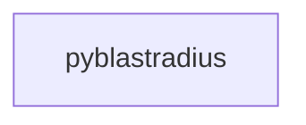

_Generated by CodeAtlas._

## Details

Owns 0 symbols across 0 file(s).

### pyblastradius

Owns 75 symbols across 7 file(s).

**Related Classes/Methods:** _None_

**Source Files:**

- `python/pyblastradius/analysis.py`
  - `python.pyblastradius.analysis.AnomalyDetector`
  - `python.pyblastradius.analysis.AnomalyDetector.__init__`
  - `python.pyblastradius.analysis.AnomalyDetector.detect`
  - `python.pyblastradius.analysis.AnomalyDetector.detect_all`
  - `python.pyblastradius.analysis.HiddenDependencyDetector`
  - `python.pyblastradius.analysis.HiddenDependencyDetector.__init__`
  - `python.pyblastradius.analysis.HiddenDependencyDetector.detect`
- `python/pyblastradius/cli.py`
  - `python.pyblastradius.cli.LocalDiscoverer`
  - `python.pyblastradius.cli.LocalDiscoverer.__init__`
  - `python.pyblastradius.cli.LocalDiscoverer.discover`
  - `python.pyblastradius.cli.UriParser`
  - `python.pyblastradius.cli.UriParser.create_discoverer`
  - `python.pyblastradius.cli.UriParser.parse`
  - `python.pyblastradius.cli.analyze`
  - `python.pyblastradius.cli.analyze.resolve_names`
  - `python.pyblastradius.cli.cli`
  - `python.pyblastradius.cli.criticality`
  - `python.pyblastradius.cli.generate_interactive_html`
  - `python.pyblastradius.cli.get_risk_level`
  - `python.pyblastradius.cli.main`
  - `python.pyblastradius.cli.scan`
  - `python.pyblastradius.cli.server`
  - `python.pyblastradius.cli.simulate`
  - `python.pyblastradius.cli.visualize`
- `python/pyblastradius/config.py`
  - `python.pyblastradius.config.AlertConfig`
  - `python.pyblastradius.config.AnalysisConfig`
  - `python.pyblastradius.config.Config`
  - `python.pyblastradius.config.Config.__init__`
  - `python.pyblastradius.config.Config._add_source_from_uri`
  - `python.pyblastradius.config.Config._load_from_dict`
  - `python.pyblastradius.config.Config._resolve_env_vars`
  - `python.pyblastradius.config.Config._resolve_env_vars.resolve_value`
  - `python.pyblastradius.config.Config._resolve_env_vars.resolve_value.replace_env`
  - `python.pyblastradius.config.Config.create_discoverers`
  - `python.pyblastradius.config.Config.default`
  - `python.pyblastradius.config.Config.load_from_file`
  - `python.pyblastradius.config.Config.merge_cli_args`
  - `python.pyblastradius.config.Config.to_dict`
  - `python.pyblastradius.config.Config.validate`
  - `python.pyblastradius.config.DiscoverySource`
  - `python.pyblastradius.config.OutputConfig`
- `python/pyblastradius/discovery.py`
  - `python.pyblastradius.discovery.Discoverer`
  - `python.pyblastradius.discovery.Discoverer.discover`
  - `python.pyblastradius.discovery.Node`
  - `python.pyblastradius.discovery.Node.__init__`
- `python/pyblastradius/integrations.py`
  - `python.pyblastradius.integrations.DbtManifestParser`
  - `python.pyblastradius.integrations.DbtManifestParser.__init__`
  - `python.pyblastradius.integrations.DbtManifestParser.extract_column_lineage`
  - `python.pyblastradius.integrations.DbtManifestParser.parse_manifest`
  - `python.pyblastradius.integrations.OtelCollectorClient`
  - `python.pyblastradius.integrations.OtelCollectorClient.__init__`
  - `python.pyblastradius.integrations.OtelCollectorClient.discover_dependencies`
  - `python.pyblastradius.integrations.StatGuardianClient`
  - `python.pyblastradius.integrations.StatGuardianClient.__init__`
  - `python.pyblastradius.integrations.StatGuardianClient.get_quality_events`
  - `python.pyblastradius.integrations.StatGuardianClient.get_quality_rules`
  - `python.pyblastradius.integrations.StatGuardianClient.track_quality_incident`
- `python/pyblastradius/server.py`
  - `python.pyblastradius.server.AnalysisRequest`
  - `python.pyblastradius.server.CriticalityRequest`
  - `python.pyblastradius.server.DiscoveryRequest`
  - `python.pyblastradius.server._cors_origins`
  - `python.pyblastradius.server._enforce_rate_limit`
  - `python.pyblastradius.server._load_api_keys`
  - `python.pyblastradius.server.analyze`
  - `python.pyblastradius.server.analyze.names`
  - `python.pyblastradius.server.criticality`
  - `python.pyblastradius.server.get_analysis`
  - `python.pyblastradius.server.health_check`
  - `python.pyblastradius.server.list_graphs`
  - `python.pyblastradius.server.load_graph`
  - `python.pyblastradius.server.openapi`
  - `python.pyblastradius.server.require_api_key`
  - `python.pyblastradius.server.run_server`
  - `python.pyblastradius.server.scan`
  - `python.pyblastradius.server.status`
